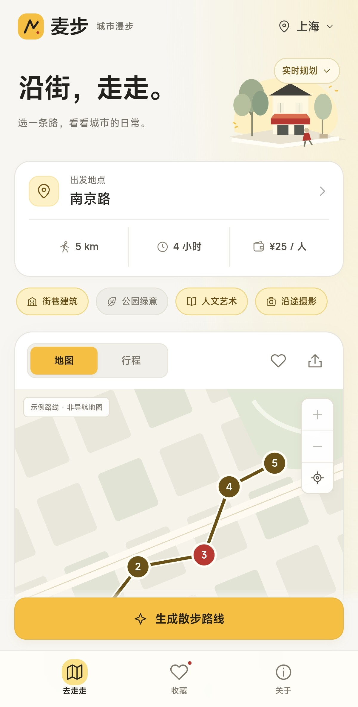
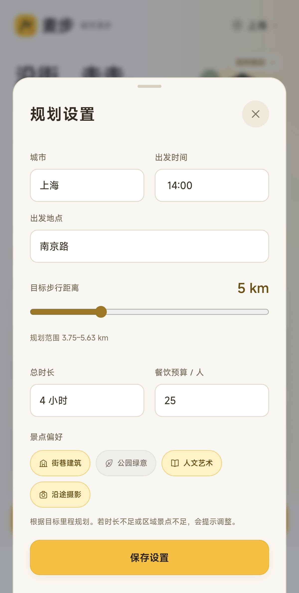
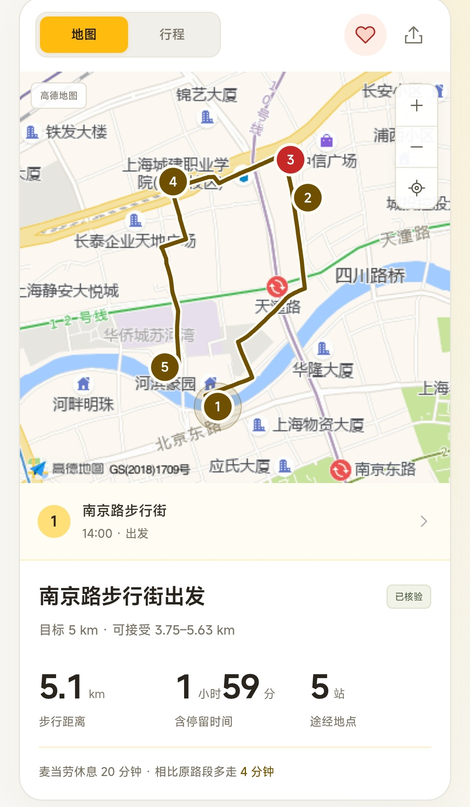
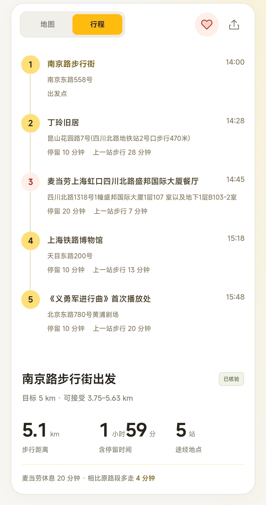
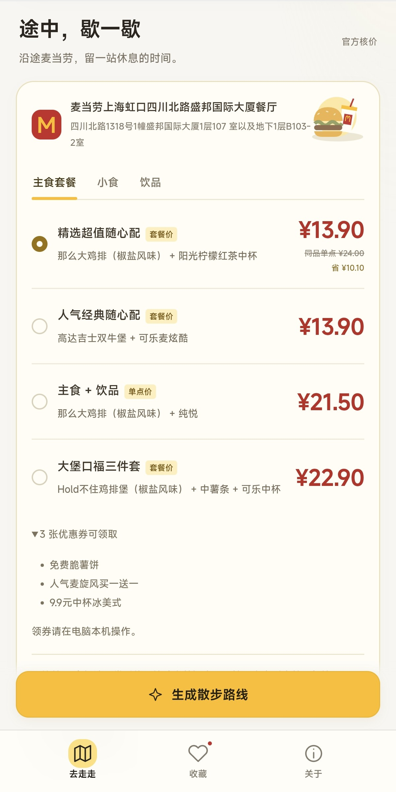

<div align="center">
  
  <h1>McWander · 麦步</h1>
  <p><strong>沿街，走走。途中，歇一歇。</strong></p>
  <p>面向移动端的 Citywalk 路线规划工具<br>结合高德地图与麦当劳 MCP，串联城市风景、沿途门店与优惠餐品。</p>
  <p>
    
    
    
    
  </p>
  <p>
    <a href="#界面预览">界面预览</a> ·
    <a href="#快速开始">快速开始</a> ·
    <a href="#手机访问">手机访问</a> ·
    <a href="#它如何工作">它如何工作</a> ·
    <a href="MCP_INTEGRATION.md">MCP 集成</a>
  </p>
</div>

---

周末空出几小时，选一个出发点，让街巷、公园和老建筑成为沿途的风景。走累了，再顺路到麦当劳坐一会儿。

**McWander** 为喜欢城市漫步、拍照与轻量探索的人而做：按照步行距离、可用时间和餐饮预算规划行程，把“去哪走”和“在哪歇”放在一起考虑。

## 界面预览

<table>
  <tr>
    <td width="33%" align="center" valign="top"><strong>01 · 进入首页</strong><br><sub>城市、出发点与偏好，一眼可见</sub><br><br></td>
    <td width="33%" align="center" valign="top"><strong>02 · 规划设置</strong><br><sub>设置起点、步行距离与可用时间</sub><br><br></td>
    <td width="33%" align="center" valign="top"><strong>03 · 地图预览</strong><br><sub>真实步行路线与沿途休息站</sub><br><br></td>
  </tr>
  <tr>
    <td width="33%" align="center" valign="top"><strong>04 · 文字行程</strong><br><sub>按时间展开，每一站都有安排</sub><br><br></td>
    <td width="33%" align="center" valign="top"><strong>05 · 麦当劳查价</strong><br><sub>比较套餐、单点与门店可用券</sub><br><br></td>
    <td width="33%" align="center" valign="top"><strong>06 · 收藏路线</strong><br><sub>喜欢的街巷，留给下一次出门</sub><br><br></td>
  </tr>
</table>

> 截图展示了从南京路步行街出发的一次查询：目标 **5 km**，返回 **5.1 km / 119 分钟 / 5 站**。截图中的 **¥13.90** 等价格为查询时快照，不代表当前或未来到店价格。

## 可以做什么

| | 功能 | 体验 |
| :---: | :--- | :--- |
| 🗺️ | 按目标里程规划 | 结合真实道路距离与可用时间，规划接近目标长度的多站步行路线 |
| 🌿 | 按兴趣选景点 | 街巷建筑、公园绿意、人文艺术、沿途摄影，自由组合 |
| 🍟 | 插入沿途休息站 | 比较候选麦当劳门店的绕路成本，并检查返回的营业窗口 |
| 💛 | 查询餐品与优惠 | 比较套餐、门店可用券和单点组合，通过麦当劳 MCP 实际核价 |
| 📍 | 地图与行程切换 | 拖动、缩放地图，点选编号查看站点与时间安排 |
| 🔖 | 收藏与分享 | 本设备收藏、导出 PNG 行程卡片、复制行程文字 |

金黄、暖白和深黑构成主要配色，搭配粗体无衬线与街景插画，优先照顾手机上的阅读与操作。

## 快速开始

### 1. 启动示例体验

需要 **Node.js 22+**。应用没有第三方运行时依赖，无需执行 `npm install`。

```bash
git clone https://github.com/Sirius0o0/McWander.git
cd McWander
cp .env.example .env.local
npm run dev
```

打开 [http://127.0.0.1:4173/?demo=1](http://127.0.0.1:4173/?demo=1)，无需填写凭证即可体验上海、杭州、成都的固定示例。示例路线、时间、地图和价格均有标记，不用于实际导航或购买。

### 2. 开启实时规划

在本机 `.env.local` 中填写两项凭证：

```dotenv
MCD_MCP_TOKEN=your_mcd_mcp_token
AMAP_WEB_SERVICE_KEY=your_amap_web_service_key
```

| 配置项 | 获取方式 |
| :--- | :--- |
| `MCD_MCP_TOKEN` | 在 [麦当劳 MCP 开放平台](https://open.mcd.cn/mcp) 登录并申请 Token，参见 [官方接入指南](https://github.com/M-China/mcd-mcp-server) |
| `AMAP_WEB_SERVICE_KEY` | 在高德开放平台创建应用，申请 **Web 服务**类型的 Key，参见 [官方开发指南](https://lbs.amap.com/api/webservice/guide/create-project/get-key) |

保存后重启 `npm run dev`，打开 [http://127.0.0.1:4173/](http://127.0.0.1:4173/)。两项配置均存在时，界面默认选择“实时规划”；首次生成才会实际调用服务。

凭证仅由 Node.js 后端读取。`.env.local` 已被 Git 忽略，浏览器不接收 Token、地图 Key 或账号券凭证。

### 3. 规划一段自己的路

1. 点击出发地点，填写城市、具体起点和出发时间。
2. 调整目标步行距离、总时长、餐饮预算与兴趣。
3. 点击“生成散步路线”，等待地点搜索、道路距离校正与餐品核价。
4. 在地图和行程间切换，查看门店与餐品；喜欢的路线可以收藏或分享。

例如：**上海 · 武康大楼 · 14:00 · 8 km · 3 小时 · ¥25 / 人**。目标 8 km 的接受范围是 **6–9 km**，不满足距离或时间条件时会提示调整，并保留此前的路线。

## 手机访问

电脑与手机连接同一 Wi-Fi，或由手机开启热点、电脑连接热点，然后运行：

```bash
npm run dev:lan
```

在手机浏览器中打开终端显示的 `http://<电脑局域网 IPv4>:4173/`。录屏或使用期间，保持电脑、网络连接与终端服务运行；切换网络后需重启服务并使用新地址。

- 支持实时路线、门店、菜单、券与价格查询，以及地图底图。
- 局域网模式仅开放查询，拒绝领券等账号修改操作。
- Windows 若无法访问，需允许同一子网访问 Node.js 的 TCP **4173** 端口。仓库提供 [防火墙配置脚本](scripts/enable-lan-firewall.ps1)，需在管理员 PowerShell 中执行。
- 在地址后加 `?demo=1` 可默认进入示例体验。

当前提供本地与局域网运行方式，没有公共在线演示地址。

## 它如何工作


**路线**：根据目标里程扩大候选区域，搜索多站点组合，再用高德实际步行距离校正。默认接受目标的 **75%–112.5%**，同时检查可用时间和门店营业窗口。

**餐品**：查询当前门店菜单、套餐选配与可用券，再分别调用 `calculate-price`。有可靠的同品单点核价结果时，才显示对应差价；主食、小食和饮品分组展示。

**领券**：本机模式下，用户主动点击并确认后才执行 `auto-bind-coupons`，随后重新检查门店可用性与价格。规划不会自动领券，也没有下单、支付或积分兑换入口。

完整工具、调用流程和实现细节见 [MCP_INTEGRATION.md](MCP_INTEGRATION.md)。

## 开发与 Skill

前端使用原生 HTML、CSS、JavaScript 与 SVG，后端使用 Node.js HTTP 服务。网页与 CLI 共用规划模块，无需构建步骤。

```bash
# 单元测试：无需凭证，不请求外部服务
npm test

# 服务连接检查：需要本机配置，只查询，不输出凭证
npm run doctor

# Skill / CLI 示例输出
node scripts/plan.mjs --demo
```

- [SKILL.md](SKILL.md)：智能体入口、输入字段与操作边界。需与整个项目一起保留。
- [开发说明](docs/DEVELOPMENT.md)：目录结构、CLI 实时调用、浏览器 QA 与局域网检查。
- [MCP 配置示例](mcp-config.example.json)：仅包含环境变量占位符。
- [实现参考](references/discount-research.md)：公开参赛项目中优惠比较方法的来源说明。

## 使用边界

- 路线来自有限候选搜索，不保证全局最优；起点采用高德文本搜索的首个有效地点，请核对名称与地址。
- 时间包含估计停留，景点门票、预约、开放时间及内部设施未核验。
- 餐品、价格、优惠券和营业信息是查询快照，未来库存与到店价格以官方渠道为准；不保证全菜单最低价。
- 收藏保存在当前浏览器，属于查询快照。出发前建议重新生成；实时查询失败不会静默替换为示例数据。

## 参赛与致谢

项目为 [麦当劳程序员创意开发大赛](https://github.com/M-China/mcd-developer-innovation-challenge) 准备，保留官方原文 [CONTEST_DECLARATION.md](CONTEST_DECLARATION.md)。仓库发布与报名 Issue 是不同步骤，发布仓库不会自动完成报名。

感谢麦当劳 MCP 与高德地图提供的数据能力，以及公开参赛项目分享的实现思路。项目未使用 WorkBuddy，不申报其开发专项奖励。

---

<div align="center">
  <sub>McWander · 麦步<br>独立开发作品，非麦当劳或高德官方产品。</sub>
</div>
